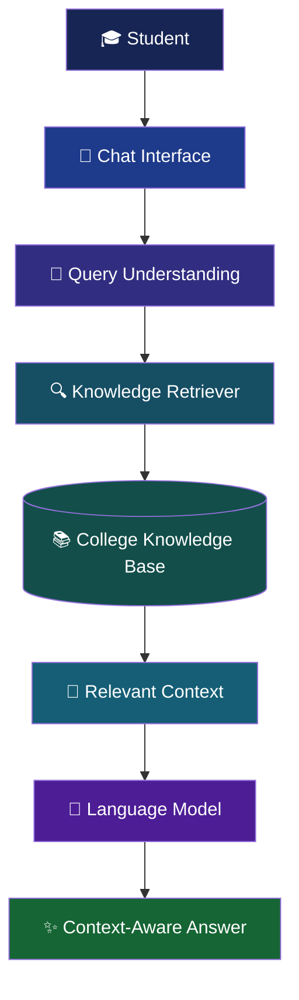
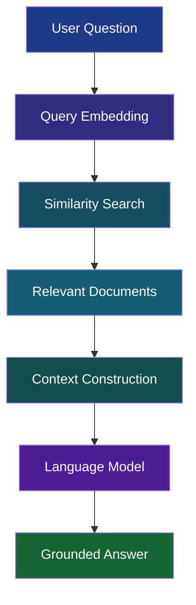

<div align="center">


<br/>


<br/><br/>

**An AI-powered conversational assistant designed to simplify how students access college information.**

<br/>


<br/>

[Overview](#-overview) · [Architecture](#-system-architecture) · [Features](#-key-features) · [Installation](#-getting-started) · [Future Scope](#-future-scope)

</div>

---

## ◈ Overview

College AI Helpdesk is an AI-powered student assistance system that provides quick and context-aware answers to common college-related questions.

College information is often scattered across PDFs, notices, websites, academic documents and administrative resources.

Finding the right information shouldn't require searching through dozens of documents.

**The idea is simple: One conversational interface. Multiple sources of college information.**

The system combines:

- Natural Language Processing (NLP)
- Large Language Models (LLMs)
- Retrieval-Augmented Generation (RAG)
- College-specific Knowledge Base
- Intent Classification

Instead of depending entirely on pretrained model knowledge, the system retrieves relevant institutional information before generating responses.

---

## ◈ The Problem

Students regularly need information about:

| Category | Information |
|---|---|
| Admissions | Eligibility, application procedures |
| Academics | Courses, departments, faculty |
| Examinations | Examination-related information |
| Administration | Fees, rules and procedures |
| Student Services | Scholarships and facilities |
| Campus | Infrastructure and important contacts |

Information exists, but accessing it efficiently is the challenge.

## ◈ The Solution

College AI Helpdesk aims to become a centralized conversational interface for institutional information.

**Ask a question → Retrieve relevant information → Generate a grounded response.**

---

## ◈ System Architecture

<div align="center">




</div>

### How it works

1. Student submits a natural-language question.
2. The system processes and understands the query.
3. Relevant information is retrieved from the college knowledge base.
4. Retrieved information is converted into context.
5. The language model generates a response using that context.
6. The student receives a context-aware answer.

---

## ◈ Retrieval-Augmented Generation (RAG)

RAG is the central concept behind this project.

Rather than asking an LLM to answer everything using only its pretrained knowledge, the system first retrieves relevant college-specific information.



**Example**

Student asks:

> What documents are required for admission?

The system searches the college knowledge base for relevant admission information and provides that context to the language model before generating an answer.

---

## ◈ Key Features

| Feature | Description |
|---|---|
| College-Specific Knowledge | Designed around institutional information |
| Natural Language Interaction | Ask questions conversationally |
| RAG-Based Responses | Retrieve relevant information before generation |
| Intent Recognition | Identify the purpose of student queries |
| Expandable Knowledge Base | Extend information as institutional data changes |
| Conversational Interface | Interact through a chat-based interface |

### Supported Query Categories

- Admissions
- Course Information
- Faculty
- Examinations
- Scholarships
- Timetables
- Departments
- Campus Facilities
- Contact Information
- General Queries

---

## ◈ Technology Stack

<div align="center">

| Layer | Technologies |
|---|---|
| Programming | Python |
| Backend | Flask |
| NLP | Python NLP Ecosystem |
| Deep Learning | PyTorch / TensorFlow |
| Machine Learning | Scikit-learn |
| LLM | Language Model API / Local Model |
| Retrieval | RAG |
| Data Processing | Pandas |
| Database | SQLite |
| Frontend | HTML, CSS, JavaScript |
| Version Control | Git & GitHub |

</div>

---

## ◈ Project Structure

```text
college-ai-helpdesk/
│
├── app.py
├── brain.py
├── phase2.py
│
├── dataset/
│   └── college_dataset.jsonl
│
├── knowledge_base/
│   └── college_knowledge_base.pdf
│
├── models/
│   └── checkpoints/
│
├── templates/
│   └── index.html
│
├── static/
│   └── style.css
│
├── database/
│   └── app.db
│
├── requirements.txt
└── README.md
```

---

## ◈ Getting Started

### 1. Clone the Repository

```bash
git clone YOUR_REPOSITORY_URL
```

### 2. Enter the Project Directory

```bash
cd college-ai-helpdesk
```

### 3. Create a Virtual Environment

```bash
python -m venv .venv
```

**Windows:**

```bash
.venv\Scripts\activate
```

**Linux / macOS:**

```bash
source .venv/bin/activate
```

### 4. Install Dependencies

```bash
pip install -r requirements.txt
```

### 5. Run the Application

```bash
python app.py
```

Open your browser and visit:

```text
http://127.0.0.1:5000
```

*Note: The installation instructions assume the repository contains the documented files and that its dependencies are configured in requirements.txt.*

---

## ◈ Limitations

The current prototype has some limitations:

- Response quality depends on knowledge base completeness.
- Institutional information requires regular updates.
- LLM-generated administrative information needs verification.
- Ambiguous questions may require clarification.
- The prototype does not replace official administrative communication.

For official deadlines, fees and examination information, students should verify answers against the latest official college communication.

---

## ◈ Future Scope

The project has several possible directions for further development.

| Area | Planned Extension |
|---|---|
| Communication | Voice-based assistance |
| Language | Hindi-English conversational support |
| Integration | College website integration |
| Messaging | WhatsApp integration |
| Knowledge | Automatic document indexing |
| Retrieval | Semantic search across college documents |
| Personalization | Student dashboards |
| Intelligence | Agent-based academic assistance |
| Platform | Mobile application |

---

## ◈ Research Direction

This project can serve as a foundation for exploring domain-specific LLM and RAG systems for educational institutions.

Potential research directions:

- Retrieval accuracy
- Hallucination reduction
- Domain adaptation
- Context management
- Educational question-answering evaluation
- Multilingual retrieval
- Long-document question answering

**Research Pipeline**

```text
College Knowledge Base
        ↓
     Retrieval
        ↓
     Reasoning
        ↓
 Grounded Generation
        ↓
  Student Assistance
```

---

## ◈ Project Status

<div align="center">

### 🟢 Active Development

The project is currently being developed as a research-oriented prototype for college-specific AI assistance.

</div>

---

## ◈ Author

<div align="center">


### Priyanshu Kumar Verma

**AI/ML Researcher**

Interested in exploring and building systems around:

`Artificial Intelligence` · `NLP` · `LLMs` · `RAG` · `Computer Vision` · `AI Research`

<br/>

[](https://github.com/priyanshukumarverma091-hub)
[](https://www.linkedin.com/in/priyanshu-kumar-verma-87501a3b5/)

</div>

---

<div align="center">

**Built with curiosity, research and a vision to make information more accessible.**


</div>
