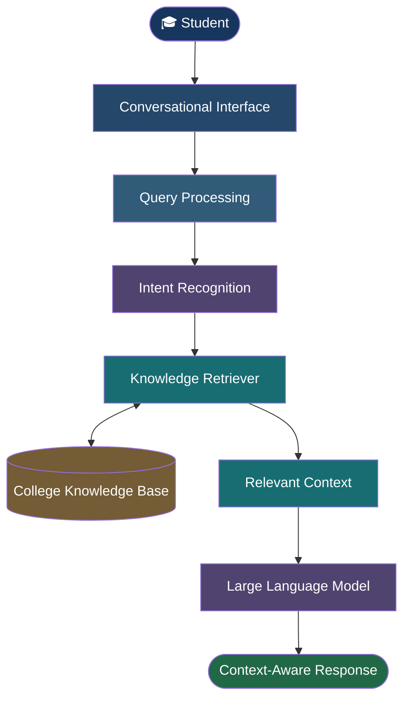
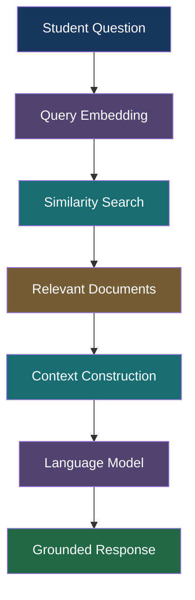

<div align="center">


<br/>


<br/><br/>

<table>
<tr>
<td align="center" width="33%">
<h2>01</h2>
<b>DISCOVER</b>
<br/>
<sub>Explore institutional knowledge</sub>
</td>
<td align="center" width="33%">
<h2>02</h2>
<b>UNDERSTAND</b>
<br/>
<sub>Natural language intelligence</sub>
</td>
<td align="center" width="33%">
<h2>03</h2>
<b>CONNECT</b>
<br/>
<sub>AI-powered student assistance</sub>
</td>
</tr>
</table>

<br/>


<br/><br/>

*An academic experience reimagined through artificial intelligence.*

</div>

---

<div align="center">

### THE VISION

**One Campus. One Knowledge System. One Intelligent Interface.**

</div>

## 01 — The Introduction

College information should be easy to access.

Yet students often need to navigate multiple PDFs, notices, websites, academic documents and administrative resources just to find a simple answer.

**College AI Helpdesk** is an AI-powered student assistance system designed to simplify this experience.

It combines Natural Language Processing, Large Language Models and Retrieval-Augmented Generation (RAG) to provide context-aware answers to college-related questions.

Rather than relying entirely on pretrained model knowledge, the system retrieves relevant institutional information before generating an answer.

The objective is to create a centralized conversational interface for institutional knowledge.

---

## 02 — The Challenge

### Information is available. Accessibility is the problem.

Students frequently search for information related to:

| Academic Information | Administrative Information |
|:---|:---|
| Courses and departments | Admissions |
| Faculty information | Fees |
| Examination details | Scholarships |
| Timetables | College procedures |
| Academic resources | Important contacts |
| Campus facilities | College rules |

Traditional information systems often require students to manually search through multiple sources.

This project explores a different approach:

> What if students could simply ask their college a question?

---

## 03 — The Intelligence Behind the System

<div align="center">

### NLP + LLM + RAG + Institutional Knowledge

</div>

The system combines multiple AI concepts into a unified workflow.

| Component | Responsibility |
|:---|:---|
| NLP | Understanding natural-language queries |
| Intent Classification | Identifying the purpose of a question |
| Knowledge Base | Maintaining college-specific information |
| Retriever | Finding relevant information |
| LLM | Generating context-aware responses |
| RAG | Connecting retrieved knowledge with generation |

### The Core Idea

```text
        STUDENT
           |
           v
     ASK A QUESTION
           |
           v
    QUERY UNDERSTANDING
           |
           v
    KNOWLEDGE RETRIEVAL
           |
           v
    RELEVANT INFORMATION
           |
           v
     LLM GENERATION
           |
           v
    CONTEXT-AWARE ANSWER
```

---

## 04 — System Architecture

The architecture is designed around the interaction between a conversational interface, institutional knowledge and a language model.



### Processing Stages

**01. Input**

The student submits a question through the conversational interface.

**02. Understanding**

The query is processed to understand its intent and context.

**03. Retrieval**

Relevant information is searched within the institutional knowledge base.

**04. Context Construction**

Retrieved information is prepared for the language model.

**05. Generation**

The LLM generates an answer using the available context.

**06. Response**

The student receives a context-aware response.

---

## 05 — The RAG Engine

<div align="center">

### RETRIEVAL-AUGMENTED GENERATION

*Giving language models access to relevant institutional knowledge.*

</div>

RAG is a central architectural concept in this project.

A conventional language model generates responses using its learned parameters. A RAG-based system additionally retrieves relevant external information before generation.

This allows the assistant to use college-specific information when responding to student queries.



### Example Interaction

**Student asks:**

> What documents are required for admission?

**System workflow:**

1. Understand the admission-related query.
2. Search relevant admission information.
3. Retrieve matching institutional knowledge.
4. Supply the retrieved context to the LLM.
5. Generate an answer based on the available information.

The quality of the answer depends on the relevance and completeness of the available knowledge.

---

## 06 — The Knowledge Library

The knowledge base acts as the institutional information layer.

It can contain structured information about:

- College profile
- Academic programs
- Departments
- Faculty
- Admissions
- Examinations
- Student services
- Infrastructure
- Rules and regulations
- Contact information
- Frequently asked questions

The project also includes a structured conversational dataset designed around college-related queries.

The knowledge base can be extended as institutional information changes.

---

## 07 — Understanding Student Intent

Different questions require different types of information.

The intent-classification layer is designed to identify the purpose behind student queries.

### Supported Intent Categories

| Intent | Example |
|:---|:---|
| Admission | Admission-related questions |
| Courses | Available academic programs |
| Faculty | Faculty-related information |
| Examination | Examination information |
| Scholarship | Scholarship queries |
| Timetable | Class schedule queries |
| Departments | Department information |
| Facilities | Campus facilities |
| Contact | Important contact information |
| General | Other college-related questions |

This layer helps route queries towards the appropriate information and retrieval workflow.

---

## 08 — Project Capabilities

<div align="center">

| CAPABILITY | PURPOSE |
|:---|:---|
| COLLEGE KNOWLEDGE | Institutional information access |
| NATURAL LANGUAGE | Conversational interaction |
| INTENT RECOGNITION | Query categorization |
| RAG ARCHITECTURE | Context-aware generation |
| KNOWLEDGE EXPANSION | Extendable information repository |
| CONVERSATIONAL AI | Student-oriented interface |

</div>

### A Different Approach to Student Support

The objective is not simply to build another chatbot.

It is to explore how domain-specific AI systems can make institutional information more accessible, searchable and understandable.

---

## 09 — Technology & Engineering

<div align="center">

### THE TECHNOLOGY FOUNDATION

</div>

| Layer | Technology |
|:---|:---|
| Programming Language | Python |
| Backend Framework | Flask |
| Natural Language Processing | Python NLP Ecosystem |
| Deep Learning | PyTorch / TensorFlow |
| Machine Learning | Scikit-learn |
| Language Model | Language Model API / Local Model |
| Retrieval Architecture | RAG |
| Data Processing | Pandas |
| Database | SQLite |
| Frontend | HTML, CSS, JavaScript |
| Development | VS Code / Google Colab |
| Version Control | Git / GitHub |

---

## 10 — Repository Structure

```text
college-ai-helpdesk/
│
├── app.py
├── brain.py
├── phase2.py
│
├── dataset/
│   └── college_dataset.jsonl
│
├── knowledge_base/
│   └── college_knowledge_base.pdf
│
├── models/
│   └── checkpoints/
│
├── templates/
│   └── index.html
│
├── static/
│   └── style.css
│
├── database/
│   └── app.db
│
├── requirements.txt
└── README.md
```

---

## 11 — Getting Started

Want to explore the project locally?

Follow these steps.

### Prerequisites

- Python installed
- Git installed
- Project dependencies
- Required model/API configuration, if applicable

### Step 1 — Clone the Repository

```bash
git clone YOUR_REPOSITORY_URL
```

### Step 2 — Navigate to the Project

```bash
cd college-ai-helpdesk
```

### Step 3 — Create a Virtual Environment

```bash
python -m venv .venv
```

**Windows**

```bash
.venv\Scripts\activate
```

**Linux / macOS**

```bash
source .venv/bin/activate
```

### Step 4 — Install Dependencies

```bash
pip install -r requirements.txt
```

### Step 5 — Start the Application

```bash
python app.py
```

### Step 6 — Open in Browser

```text
http://127.0.0.1:5000
```

*Note: These commands assume the repository contains the corresponding files and configured dependencies.*

---

## 12 — Research Possibilities

<div align="center">

### BEYOND A STUDENT CHATBOT

*Exploring domain-specific intelligence for educational institutions.*

</div>

This project provides a foundation for exploring several research questions.

| Research Area | Research Direction |
|:---|:---|
| Retrieval Accuracy | Improving relevant document retrieval |
| Hallucination Reduction | Grounding generated responses |
| Domain Adaptation | Adapting AI systems to institutional knowledge |
| Context Management | Handling contextual information |
| Educational QA | Evaluating question-answering systems |
| Multilingual Retrieval | Supporting multilingual information access |
| Long Documents | Improving document-based question answering |

### Research Pipeline


---

## 13 — Future Development

The project has opportunities for further expansion.

| Direction | Potential Development |
|:---|:---|
| Voice | Voice-based student assistance |
| Language | Hindi-English interaction |
| Integration | College website integration |
| Messaging | WhatsApp integration |
| Documents | Automatic document indexing |
| Retrieval | Semantic document search |
| Personalization | Student dashboards |
| Automation | Agent-based academic assistance |
| Platform | Mobile application |
| Updates | Real-time notice retrieval |

*These are potential extensions, not claims about currently implemented functionality.*

---

## 14 — Limitations & Responsible Use

The current prototype has certain limitations:

1. Response quality depends on the completeness of the knowledge base.
2. Institutional information requires regular maintenance.
3. Generated administrative information requires verification.
4. Ambiguous questions may need clarification.
5. The system is not a replacement for official administrative communication.

For official deadlines, examination schedules, fees and institutional policies, students should verify information through official college communication.

---

## 15 — Development Status

<div align="center">


<br/><br/>

**A Research-Oriented Prototype**

The project is being developed to explore the intersection of artificial intelligence, institutional knowledge and conversational student assistance.

</div>

---

## 16 — About the Researcher

<div align="center">


<br/>

### PRIYANSHU KUMAR VERMA

**AI/ML Researcher**

Exploring intelligent systems, machine learning architectures and practical applications of artificial intelligence.

<br/>

[](https://github.com/priyanshukumarverma091-hub)

[](https://www.linkedin.com/in/priyanshu-kumar-verma-87501a3b5/)

<br/>

**Areas of Interest**

`Artificial Intelligence` · `Machine Learning` · `NLP` · `LLMs` · `RAG` · `Computer Vision`

</div>

---

<div align="center">

### AN IDEA. AN INSTITUTION. AN INTELLIGENT FUTURE.

*Making institutional knowledge easier to discover, understand and access.*

<br/>


</div>
